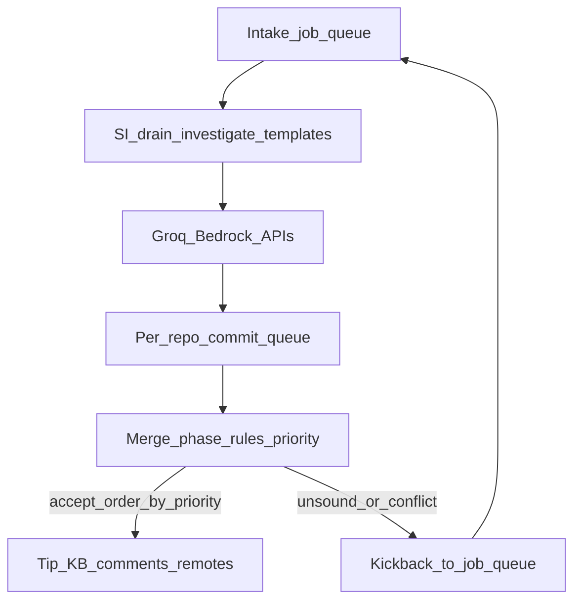

# Batch phases (Relay-wide SoT)

**Canonical product phases for MyProblem, QuizGate, and Clevertree Chat.**  
Other docs point here when they talk about Cursor-as-batch, automated batch go-live, or the shared queue.

Related: [`projects.md`](./projects.md) · [`intake-batch-infra.md`](./intake-batch-infra.md) · [`providers-ai.md`](./providers-ai.md) · [`batched-agent-work.md`](./batched-agent-work.md) · [`cursor-batch-playbook.md`](./cursor-batch-playbook.md) · [`ephemeral-media.md`](./ephemeral-media.md) · [`knowledge-base.md`](./knowledge-base.md) · [`confidence-gauge.md`](./confidence-gauge.md) · LLC [`../relay/clevertree-llc-plan/07-step-by-step.md`](../../relay/clevertree-llc-plan/07-step-by-step.md) (maps to these phases).

---

## Locked decisions

| Topic | Decision |
|---|---|
| Always-on Intake / API | **Cache + enqueue only** — uploads of any format/topic, IRC log batches, capture batches. **No git/repo mutations** until a batch agent runs |
| Phase 1 batch agent | **Cursor** on the operator machine (**ask + local cron**) |
| Phase 2 | Automated batch SI on **CPU + API providers** (Groq / Bedrock / peers) when parity, tests, and operator confidence allow — **no batch GPU fleet** |
| AI | **Providers only** for ASR, VL, video, and think — context/KB/rules, not custom training ([`providers-ai.md`](./providers-ai.md)) |
| Queue | **One shared batch queue** for MyProblem, QuizGate, and Clevertree |
| Ticket remotes | **Private** — UUID tips + `comments` / debates |
| KB remotes | **Public** — redacted advice, best sources, prompts, escalate recipes (cite live web; do not mirror it) |
| Pilot remotes | `myproblem-tickets-georgia`, `myproblem-tickets-israel`, one `myproblem-kb` with `georgia/` + `israel/` (+ `general/`) partitions |
| Progressive mint | Extra private+public **pairs** only when a craft does not fit (e.g. FixIt) — not one repo per ticket |
| Uploads | **Bunny** for all sites, via **per-repo upload-source** config (user upload + server curation / choice-frame re-upload) |
| Forum platforms | **Per-repo** `forum-platforms.json` (like Bunny): how `[[nd:group/post]]` maps to Nextdoor URLs; craft IRC e.g. `#ga-savannah-cat-rescue` — not a Relay-global UUID space |
| Forum collections | Localized roster of groups to sync (e.g. `savannah-cat-rescue`); not a category; tip home stays the region remote |
| IRC / WS chat logs | Host cache ephemeral; batch may store minimized transcripts in comments SoT (`pages/<page>/chat/`, short ids) unless `chat_store: never` |
| Confidence | (a) MyProblem Understanding/Solution on tips/replies; (b) **operator** batch-run confidence (correct / accurate / fast / **$**) as Phase 2 gate |
| Train / eval | Rules, fixtures, server/Cursor parity tests, **eval + model switch** — **no fine-tune gate** |
| Capacity | **No paid lane** — everyone shares Intake + provider budget; busy = honest wait; tips/donations cover servers + metered AI |
| Batch agent | **Same procedure** on Cursor (Phase 1) and automated runner (Phase 2) — only the runner differs |
| Repo writes | Drain produces **proposed commits** into a per-repo **commit queue**; remotes update only in the **merge phase** after the whole repo’s batch work for that cycle is done |
| Cost | Log and **publicize $/request** after successful provider work |

---

## Shared SI batch procedure (Cursor = automated Phase 2)

We say **SI** (Super Intelligence) for the software that invents, files, summarizes, and curates. The batch SI — whether **Cursor on the operator machine** or an **automated CPU + providers** worker — follows the **same** procedure. Phase 1 vs Phase 2 only changes *who runs* the procedure, not the steps.



### 1. Drain the job queue (per repo / site)

1. Inventory tips/topics as today (Step 0 in the playbook).
2. Process **all** pending batch jobs for that repo’s slice of the shared queue — as long as it takes: investigations, KB lookups, provider ASR/VL/video, escalate recipes, reply templates, tip/comment/KB standing outputs, Bunny choice-media, confidence stamps, **cost logs**.
3. For each finished unit of work, **do not push** to the remote tip/KB/comments remotes yet. Produce a **proposed commit** (patch + metadata) and append it to that repo’s **commit queue** for this cycle.
4. Mark the intake job done / blocked / failed with reason. Failed or blocked jobs stay visible for the next cycle.

### 2. Commit queue (batched; not live merge)

- One **commit queue per target remote** (e.g. `myproblem-tickets-georgia`, `myproblem-kb`, Clevertree comments SoT).
- Work may finish **asynchronously** (parallel jobs, multi-site). Merging on every job completion would race, conflict, and thrash the mesh.
- The commit queue holds **all** proposed commits for this cycle until the drain for that repo is complete (no more pending jobs that belong to this cycle’s slice, or the cycle’s time/budget gate closes).

### 3. Merge phase (after the repo’s batch work is done)

Only then does the SI open the commit queue and run the **merge phase**:

| Duty | Detail |
|---|---|
| **Soundness** | Check every proposed commit: Relay rules, posted `rules.md` / defaults, and a **recheck** of work the drain SI already claimed to have done |
| **Integrity** | Final pass that the drain SI’s output is coherent and not compromised (tamper, absurd diffs, rule evasion) |
| **Conflict / mesh** | Analyze the whole set for git conflicts, duplicate tips, mesh-unfriendly push storms; drop or reorder before touching remotes |
| **Kickback** | Unsound or unresolvable items are **removed from this merge** and **re-queued** on the job queue (often the **next** cycle) so operators and the next drain see the error — not a silent infinite loop in one pass |
| **Give up** | If reprocess still has no solution after the documented retry budget, mark **failed / human** — do not cycle endlessly |
| **Priority merge** | Apply accepted commits in **merge priority** order — not blindly FIFO. Queue order is an input and the usual **default** priority; posted rules + Relay defaults may raise urgency or value (e.g. TNR/trapper coordination, safety) so high-value commits land first without holding unrelated queues |

Efficiency goals of the merge phase: clear the cycle without blocking other repos’ queues, minimize conflicts, and protect downstream mesh remotes from partial or hostile pushes.

### Same contract on Cursor and Phase 2

| Runner | When | Procedure |
|---|---|---|
| Cursor (Phase 1) | Ask or local cron | Drain → providers as needed → commit queue → merge phase → push remotes |
| Automated (Phase 2) | CPU worker + APIs | **Identical** steps and queues; Cursor becomes escalate / exception |

MyProblem, QuizGate, and Clevertree Chat all use this procedure. Per-product **instructions** and tip shapes differ; the **runner, queues, merge phase, and tool set** do not.

### Shared SI tool set

Across apps the batch SI may use the same capability kit (availability gated by rules and job kind): **image analysis**, **image generation**, **transcription**, **text-to-speech**, **web search** (cite live web — don’t cache scrapes into KB), **video understanding** (provider APIs), and the **knowledge base**. Product playbooks say *when* to call each tool; they do not invent a second batch pipeline or a GPU fleet.

### Every batch job ↔ tip (ticket)

Treat every queued batch item as a potential **tip create or update**. The tip is defined by the **repo** (and path pattern below). “Ticket” in product talk means that tip unit — not a separate database row outside git.

---

## Unified tip (every product)

A **Relay tip** is the simplest shared unit. Product meaning is a lens on the same structure:

| Product | Tip means | Default identity | Notes |
|---|---|---|---|
| MyProblem / FixIt | Repair / DIY / service **problem** | **Anonymous** UUID tip; PII scrubbed before standing files | Private tip remotes; Clevertree may bind a room to the **same UUID** |
| QuizGate | Whole **user** account (progress over time) | **Anonymous** `users/<uuid>/`; PII stripped from tip SoT | May split later; Clevertree may bind a room to that UUID |
| Clevertree | **Topic** / forum room | **Anonymous** visitor UUID by default; optional **chosen name** / go-as-public as the person wants | Comments SoT; may reuse another product’s tip UUID — **no forced new UUID** |

**Privacy default (all three):** private and anonymous unless the human opts into a visible name or other public handle. QuizGate and MyProblem tip remotes stay capability-private; Clevertree’s public debate map still stores short ids + optional display name, never raw PII in standing comment files.

Batch always starts by **inventorying all tips that exist** in each configured repo (not only queue jobs), then curates: assess, run pending jobs, update standing files, stamp confidence, purge obsolete cache/Bunny, or **delete** tips that are closed / empty and no longer needed publicly.

**Delete defaults:** remove tip trees with empty content (`intake=listening` / empty title / no evidence / no public slug), and closed tips with empty content. Anything with real body, media, slug, or QuizGate day progress → curate or list for human — do not silent-delete.

---

## Phase map

```
Clients / apps / IRC / APIs
        │
        ▼
Always-on Intake ── cache media + enqueue job payloads (shared queue)
        │
        ├── Phase 1 ──► Cursor (ask + cron) ──► providers + private tips + public KB + Bunny
        │
        └── Phase 2 ──► CPU + Groq/Bedrock/peers (same queue contract) ──► same remotes
```

| Product phase | What is live | Who mutates git |
|---|---|---|
| **Phase 1** | Products + Intake cache/queue | **Cursor only** |
| **Phase 1.5** | Same + fixtures, parity tests, eval / model-switch sheet | Cursor (default); automated dry-run |
| **Phase 2** | Automated batch on CPU + providers | **Automated worker** (Cursor = exception / escalate) |

**Intake live ≠ Phase 2.** The always-on host may be up and caching while automated batch is not yet the go-live drain.

---

## Phase 1 — Products live; batch is Cursor

1. Sites accept work; Intake stores **job payloads + media cache** (and IRC batches). Nothing creates tip/KB/comments commits until batch runs.
2. Product-specific auto-drains are **subordinated** to this contract: the shared queue is the SoT for pending work; Cursor is the sole repo writer.
3. Cursor (on ask or cron) runs the **shared SI batch procedure** — see above and [`cursor-batch-playbook.md`](./cursor-batch-playbook.md):
   - **Step 0:** inventory **all tips** per remote (MyProblem/FixIt problems, QuizGate users, Clevertree topics).
   - Curate each tip; drain shared-queue jobs `{site, kind, payload_ref, media_refs, rules_ref}` (investigations, reply templates, …).
   - Call providers for ASR / VL / video / decide as needed; log **$/request**.
   - Download needed Bunny/cache inputs; run site playbooks; delete empty/obsolete tips per delete defaults.
   - Enqueue **proposed commits** on the per-repo commit queue (private tips + public KB + comments); Bunny choice-media; wipe scratch.
   - When that repo’s drain for the cycle is done → **merge phase** (rules soundness, integrity, priority, kickback) → then push remotes.
   - Stamp user-facing confidence (MyProblem gauges) and **operator run confidence** (correct / accurate / fast / $).
   - Extend the batch-server stack, instructions, and tests so Phase 2 matches this same procedure.

### Site duties (Phase 1)

| Site | Tip lens | Cursor work |
|---|---|---|
| MyProblem / FixIt | Problem | Inventory tips; Understanding/Solution; frame-select → Bunny; purge/delete empty shells; KB writes; capture-batch; FixIt pack when remotes exist |
| QuizGate | User | Inventory `users/<uuid>/`; refresh profile from day-batch; parent-safe; no open generative feed; Bunny per upload source |
| Clevertree | Topic | Inventory pages; drain IRC/enqueue; bind rooms to foreign tip UUIDs when mounted; no vote/side-taking; Cursor sole SoT writer |

---

## Phase 1.5 — Parity hardening

- Golden fixtures from real Phase 1 tickets, IRC, and packs.
- Unit + scenario tests: media wipe; no repo write without batch; Bunny choice-media; KB cite-don’t-cache; confidence thresholds; multi-tenant queue routing; **cost log present**.
- Eval / model-switch loop against operator confidence + $ metrics (not fine-tune).
- Clevertree queue cutover and QuizGate batch writer aligned to the **same job schema** Cursor already drains.

---

## Phase 2 — Automated batch go-live

- CPU worker + providers runs the **same SI procedure**: shared job queue → commit queue → merge phase → remotes; same wipe + Bunny contract.
- Cursor becomes escalation / exception path, not the default drain.
- **Go-live bar (all required):**
  - Operator confidence on task correct / accurate / fast meets the recorded threshold (see ops log / eval sheet).
  - Parity tests green against Cursor golden fixtures.
  - Documented model menu (cheap default + escalate) with switch criteria — **no fine-tune required**.
  - Wipe + no-residual-scratch checks pass.
  - Multi-site queue routing verified for MyProblem + QuizGate + Clevertree job kinds.
  - `$/request` logged for provider calls.

---

## Remotes (privacy)

| Remote | Visibility | Holds |
|---|---|---|
| `myproblem-tickets-georgia` / `-israel` | private | UUID tips + `comments` |
| `myproblem-kb` | public | partitions `georgia/` `israel/` `general/` — advice, sources, prompts, escalate recipes |
| Later craft pairs (e.g. FixIt) | private + public pair | Only when catalog has no fit |

Do **not** put private tips and public KB on one git remote: clone/fetch would leak tips. Cursor checks out the pair side by side as one workspace.

---

## Bunny (all sites)

Each tip/KB/debate remote declares its **upload source** (Bunny zone/path today). Users upload; batch re-uploads scrubbed choice frames and deletes superseded cache objects. Swapping providers later = change per-repo config, not product code paths that assume a hard-coded host.

---

## Confidence (two layers)

1. **User-facing (MyProblem):** Understanding + Solution gauges — [`confidence-gauge.md`](./confidence-gauge.md). Show in replies/tips whenever possible.
2. **Operator (Phase 2 gate):** Per batch-run scores for correct / accurate / fast / **$**. Drive model switch and go/no-go for automation — not fine-tune.

---

## KB content rule

Public KB is for **SI-useful** residue: best sources, investigation prompts, escalate paths (Groq, Bedrock, …), ticket-driven assessments. **Cite** the live web; **do not** fill the KB with scrapes that go stale. See [`knowledge-base.md`](./knowledge-base.md).

---

## Video

- **Realtime path:** stills (+ audio on APK) only — no live server video analysis.
- **Deferred:** video/audio may sit in Batch inbox → **provider** ASR / video understanding / VL → Bunny choice stills → purge unused.

---

## Status

| Item | State |
|---|---|
| Product Phase | **1** (Cursor-as-batch) |
| Shared queue schema | Spec in playbook; wire Intake enqueue to match |
| Commit queue + merge phase | Spec locked in this doc + playbook; implement alongside queue cutover |
| Phase 2 automation | Not go-live until bar above |
| Batch GPU / Spot A30 AI | **Abandoned** — see [`providers-ai.md`](./providers-ai.md) |
