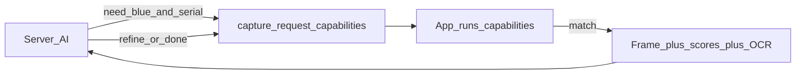

# Server → app capture guidance

The server AI does **not** re-judge shake/blur. Server and app share **capabilities** to deduce and drill down a Problem in realtime: quality/uniqueness, color/shape/angle filters, OCR text, later pose/3D.

Related: [context-for-server.md](./context-for-server.md), [onboard-ai.md](./onboard-ai.md), [progressive-transcription.md](./progressive-transcription.md), [apk-ticket-ux.md](./apk-ticket-ux.md).

**Stills / OCR** remain this capture path. **Voice** is separate: audio posts as ticket Evidence and is batch-transcribed on the server (client never calls ASR). Context patches that include OCR snippets or corrected names on an **open** ticket may trigger the progressive-transcription **LLM gate** to decide whether to re-run ASR — see that doc.

## Capabilities (not fixed layers)

| Capability | Who runs it | Typical use in an investigation |
|---|---|---|
| Frame quality + uniqueness | App (always) | Only clear, new views enter the evidence stream |
| Color / shape / angle hints | App when `capture_request` asks | “That blue fitting,” “NE face” |
| OCR (Latin) | App when text is relevant | Serial / model / label — match or keep looking |
| Brief + next ask | Server | Hypothesize; emit next `capture_request`; stop camera when done |

The server chooses **which** capabilities matter for the next turn. The app runs them on-device and reports scores + (when ready) a frame. No rigid “always OCR after always X” pipeline — OCR is just another tool when the investigation needs text.

## Protocol: `capture_request`

```json
{
  "capture_request": {
    "id": "cr_demo_blue",
    "mode": "filter",
    "hints": [
      { "type": "color", "hsv": [210, 0.45, 0.35], "tolH": 25, "tolS": 0.35, "tolV": 0.45, "minFraction": 0.04, "label": "that blue" },
      { "type": "shape", "kind": "bbox_aspect", "aspect": 1.6, "tol": 0.25 },
      { "type": "angle", "sector": "NE", "orYawDeg": 45, "tolDeg": 20 },
      { "type": "text", "contains": "SERIAL", "minLen": 2 }
    ],
    "logic": "all",
    "coach": "Hold still on the blue label from the NE — need the serial"
  }
}
```

| Hint | App capability | Server intent |
|---|---|---|
| `color` | HSV fraction ≥ min → else `wrong_target` | “Show me the blue part” |
| `shape` | Aspect / contour stub | “Match that plate” |
| `angle` | Yaw/sector within tol | “Need the left side” |
| `text` | OCR on a clear unique candidate; match → would send; miss → remember text, need a **new** unique view | “Find the serial” |

**Logic:** `all` / `any` across the hints the server included. No request → quality + uniqueness only.

**Client-only still:** shake, blur, glare, dark/bright, duplicate.

## Realtime drill-down loop



1. Server reads last evidence → hypothesis.
2. Emits `capture_request` listing the capabilities needed next (color and/or angle and/or text…).
3. App coaches the user; runs those capabilities; when evidence fits → **would send** (Test Mode: event log `Would send` / `OCR match`).
4. If text was requested but OCR is wrong/empty → keep scanning for a **new** unique image; rejected OCR strings are remembered so the same label text doesn’t spam.
5. Server updates brief; may clear request or `camera_control: stop`.

## Test Mode (no server)

Debug Hint cycles: blue → NE → TEXT/OCR → off. Event log shows capability outcomes (kept view, OCR match/reject, would send).

## Future: 3D guidance (docs only — do not build yet)

- Coarse **3D proxy** of the Problem object.
- On-screen guide rotates with attitude.
- Or: score live pose vs requested quaternion; when clear + unique + in-tol, auto-mark send-ready.
- Still sparse uploads; guide stays local.

## Voice + camera (docs only — do not build yet)

- Mic → post audio Evidence to ticket → first-pass batched ASR; LLM gate for retranscription on open tickets ([progressive-transcription.md](./progressive-transcription.md)).
- Camera = unique/worthy **stills** only within rate limits. **No video Evidence** to the server (preview must not upload a video blob).
