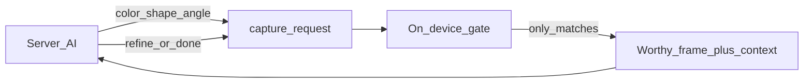

# Server → app capture guidance

The server AI does **not** re-judge shake/blur. It sends **deductive capture hints** so the on-device gate only marks frames worthy when they match coaching (e.g. “that blue,” “this angle”).

Related: [context-for-server.md](./context-for-server.md), [onboard-ai.md](./onboard-ai.md).

## Protocol: `capture_request`

```json
{
  "capture_request": {
    "id": "cr_demo_blue",
    "mode": "filter",
    "hints": [
      { "type": "color", "hsv": [210, 0.45, 0.35], "tolH": 25, "tolS": 0.35, "tolV": 0.45, "minFraction": 0.04, "label": "that blue" },
      { "type": "shape", "kind": "bbox_aspect", "aspect": 1.6, "tol": 0.25 },
      { "type": "angle", "sector": "NE", "orYawDeg": 45, "tolDeg": 20 }
    ],
    "logic": "all",
    "coach": "Hold still on the blue part from the NE"
  }
}
```

| Hint | Client gate (MVP) | Server intent |
|---|---|---|
| `color` | Fraction of sampled pixels near HSV target ≥ `minFraction` → else `wrong_target` | “Show me the blue part” |
| `shape` | Aspect / contour stub (optional; miss → `wrong_target`) | “Match that plate” |
| `angle` | Yaw/sector within tol (else `wrong_target` / sector miss) | “Need the left side” |
| `text` | Deferred (OCR) | “Find the serial” |

**Logic:** `all` = every hint must pass; `any` = one enough. No active request → L0 quality+unique only.

**Client-only still:** shake, blur, glare, dark/bright, duplicate. New drop: `wrong_target`.

## Deductive loop



1. Server reads last worthy image + context → hypothesis.
2. Emits `capture_request`.
3. App HUD shows `coach`; gate requires hint match for WORTHY.
4. Server clears or tightens; may `camera_control: stop`.

## Test Mode (no server)

Debug control injects a sample “require blue-ish” / sector hint locally to prove `wrong_target` without network.

## Future: 3D guidance (docs only — do not build yet)

- Coarse **3D proxy** (bbox / mesh / CAD-lite) of the Problem object.
- On-screen guide rotates with attitude so the user sees the target pose.
- Or: score live pose vs requested quaternion; when clear + unique + in-tol, **auto-mark worthy**.
- Upload stays sparse; guide is local; server gets worthy frame + pose + `capture_request.id`.
