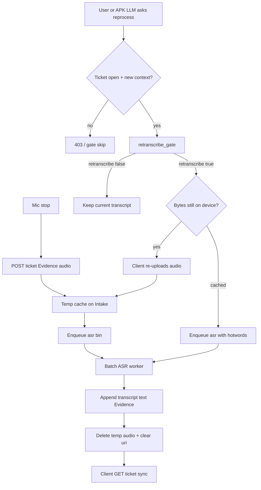

# Progressive / contextual transcription

Voice starts a **Problem ticket** by posting **audio as Evidence** (blob in cheap object store; tip holds URI). The client **never** calls an ASR / Whisper API. Transcription is a **queued, batched** server job that writes transcript Evidence back onto the ticket asynchronously.

**First audio** always enqueues cheap ASR (or a silence/duration skip). **Later context changes** on **open** tickets may trigger an **LLM gate** that decides whether to **re-transcribe** with richer hotwords / prompt context — not whether the ticket “deserves” a first transcript.

Tickets are keyed by server **`ticket_uuid`** (anonymous by default). See [`anonymous-tickets.md`](./anonymous-tickets.md).

PII in transcripts is auto-converted before tip commit — see [`pii-and-privacy.md`](./pii-and-privacy.md).

Related: [`projects.md`](./projects.md) · [`apk-ticket-ux.md`](./apk-ticket-ux.md) · [`intake-fixtures.md`](./intake-fixtures.md) · [`intake-batch-infra.md`](./intake-batch-infra.md) · [`spot-ai-mvp.md`](./spot-ai-mvp.md) · [`context-for-server.md`](./context-for-server.md) · [`capture-guidance.md`](./capture-guidance.md).

**Status:** edge + Intake APIs live; APK uploads via `TicketsApi`; media is **ephemeral** ([`ephemeral-media.md`](./ephemeral-media.md)).

---

## One-sentence rule

> **Post audio to the ticket; always batch-transcribe the first clip; reprocess only when new context would change the outcome (user or APK LLM may ask; server gate decides). Never upload video; never keep audio on the server after processing.**

---

## Hard constraints

| Rule | Why |
|---|---|
| APK / web client **must not** call a public `/api/transcribe` (or equivalent) | ASR is an investigation capability of the ticket worker, not a client utility |
| Attaching **audio Evidence** enqueues first `asr_job` (unless silence/duration skip) | Avoid deadlock: gate needs a transcript to judge later |
| Context patches / reprocess asks on **open** tickets hit `retranscribe_gate` | Gate decides whether another ASR/vision pass is worth it |
| **Server ticket** (Relay tip) is SoT for **text** + Evidence **refs** | Audio/still **bytes** are temp cache only; purge after Batch success ([`ephemeral-media.md`](./ephemeral-media.md)) |
| **Closed** tickets do not re-enter retranscription batches | Avoid infinite cost after the Problem is done |
| Reprocess is optional UX | User **or** APK on-device LLM may **suggest** reprocess; server allows only when gate says new context would change the outcome |
| **No video Evidence** on the server | Camera = unique/worthy **stills** within rate limits; preview must not upload a video blob |
| **No media in git** | Repos = tickets text + links; fixtures regenerate wavs locally |

---

## Flow



Aligns with Projects posture: **queue → batch → write back → purge** ([`projects.md`](./projects.md), [`ephemeral-media.md`](./ephemeral-media.md)).

Because audio is purged after the first successful pass, a **reprocess that needs bytes again** requires the APK to **re-upload** from the on-device cache (or the user re-records).
---

## Evidence types

| `kind` | Who writes | Notes |
|---|---|---|
| `audio` | Client (upload) | Temp cache URI until processed; then purged — tip keeps `sha256` only |
| `transcript` | Server (ASR worker) | Versioned text; refs parent `audio` Evidence id |
| `still` / OCR snippets | Capture path | See [`capture-guidance.md`](./capture-guidance.md); patches can feed the **retranscription** gate |
| ~~`video`~~ | — | **Not accepted** server-side |

### First ASR vs retranscription

| Event | Action |
|---|---|
| New `audio` Evidence | Always enqueue `asr_job` (or skip if below silence/duration threshold) |
| Context patch on open ticket that already has audio | Enqueue `retranscribe_gate_job`; LLM may enqueue another `asr_job` |
| Closed ticket | No ASR / gate jobs |

### Transcript versioning

Each ASR pass appends a new `transcript` Evidence row (do not overwrite):

```json
{
  "kind": "transcript",
  "audioEvidenceId": "ev_audio_…",
  "version": 2,
  "text": "…",
  "language": "en",
  "model": "whisper-large-v3",
  "contextSnapshot": {
    "knownNames": ["Ari"],
    "ocrSnippets": ["SERIAL 4X9"],
    "title": "Leaky valve under sink",
    "priorTranscriptVersion": 1
  },
  "jobId": "job_asr_…"
}
```

Clients show the **latest** version in the primary UI; earlier versions stay on the timeline for audit and for the gate.

---

## Job types

| Job | Trigger | Worker |
|---|---|---|
| `asr_job` | New `audio` Evidence (first pass) or gate “yes” | Batch ASR (Whisper on Spot / API behind worker). Writes `transcript` Evidence. Reads audio from object store. |
| `retranscribe_gate_job` | Context patch on an **open** ticket that already has audio (+ maybe a transcript) | Cheap LLM: decide whether a **new** ASR pass is worth it. |

There is **no** client-facing “transcribe this blob” endpoint. Workers load Evidence via tip refs → object store.

### Planned ticket API surface (for implementers)

| Route | Role |
|---|---|
| `POST /api/tickets` | Create open ticket **at mic start** (anon `ticket_uuid` + claim) — no later Submit |
| `POST /api/tickets/[id]/evidence` | Attach **audio** chunks (`chunkIndex`, `isFinal`) or **stills**; audio enqueues `asr`; **reject video**; bytes → temp cache |
| `PATCH /api/tickets/[id]` | Context / **user-locked** title/description; may feed reprocess gate |
| `POST /api/tickets/[id]/reprocess` | User or APK LLM asks re-ASR / re-vision; body includes `contextDelta`; gate must approve |
| `GET /api/tickets/[id]` | Timeline + Evidence + jobs + `coachLine` + proposed/locked title/desc |

### Live audio (chunked) + proposed title/description

| Rule | Detail |
|---|---|
| Ticket first | `POST /api/tickets` when Audio mode starts — UUID exists before first word |
| Chunks | Upload every ~2–4s + final flush; each chunk may enqueue lightweight ASR/intake |
| Coach lines | e.g. “Please state your problem.” / “Got it — keep talking to refine…” / “Please clarify… or wait for server analysis.” |
| Stop | Button or spoken **“stop recording”** (on-device recognizer for latency) |
| Proposed vs locked | Intake may revise title/desc until user edits (`locked: true`); then never auto-overwrite |
| Handoff | Light intake may set `queue_project` / `advice_ready` without a Submit step |

See also [`apk-ticket-ux.md`](./apk-ticket-ux.md).

---

## Reprocess gate (LLM / heuristic)

**When:** `POST …/reprocess` from the **user** or **APK LLM suggestion**, or after a context patch, on an **open** ticket that already has a processed transcript/OCR.

**Required:** non-empty `contextDelta` that is not already reflected in the current transcript / tip fields. Cosmetic edits → gate returns `reprocess: false`.

**Input (sketch):**

```json
{
  "ticketId": "…",
  "status": "open",
  "requestedBy": "user" | "apk_llm",
  "target": "asr" | "vision",
  "evidenceId": "…",
  "currentTranscript": { "version": 1, "text": "…" },
  "contextDelta": {
    "addedNames": ["Skinner"],
    "addedOcr": ["MODEL XJ-2"],
    "titleChanged": true,
    "newUserNote": "It's a Bosch valve"
  }
}
```

**Output (sketch):**

```json
{
  "reprocess": true,
  "reason": "Proper name and model string likely misheard in v1",
  "hotwords": ["Skinner", "XJ-2", "Bosch"],
  "needsReupload": true
}
```

- `reprocess: false` → keep current result; timeline note optional.
- `reprocess: true` + `needsReupload: true` → APK re-POSTs audio/still from device cache, then Batch runs with hotwords.
- `reprocess: true` + cache still present (rare) → enqueue without re-upload.

Gate prefers **skip**. Reprocess corrects **ASR / naming / OCR errors**, not a substitute for full Project investigation.

---

## Client sync expectations

| UI state | Meaning |
|---|---|
| `transcription: pending` | Audio Evidence accepted; first `asr_job` queued or running |
| `transcription: ready` | At least one `transcript` Evidence present |
| `transcription: updating` | Gate approved another ASR pass |

Client may keep a **local cache** of the audio file for Play / offline review. Sync of transcript text always comes from `GET` ticket — never from a direct ASR response body on upload.

---

## Video — hard no (server)

- **Start feed** = Preview + ImageAnalysis only → **no** video file upload, ever.
- Unique/worthy **stills** only, within APK + server rate limits ([`context-for-server.md`](./context-for-server.md)).
- Do **not** offer “Record video” / “Auto-record video” as a path that posts `video` Evidence.
- Optional on-device preview buffer stays on device and is discarded — never a server blob.

---

## Cache + Relay / Spot

- Tip Evidence rows may briefly point at a **temp cache** path/URL; after Batch success the URI is cleared ([`ephemeral-media.md`](./ephemeral-media.md)).
- Optional future: short-lived S3/IPFS links with the same purge contract — repos still never store bytes.
- `relay.ai.asr` ([`spot-ai-mvp.md`](./spot-ai-mvp.md)): batch worker reads from cache → Whisper → transcript Evidence → **purge**. Until Spot A30 Batch is up, Intake/ops may call hosted Whisper **from the server**, never from the APK.
