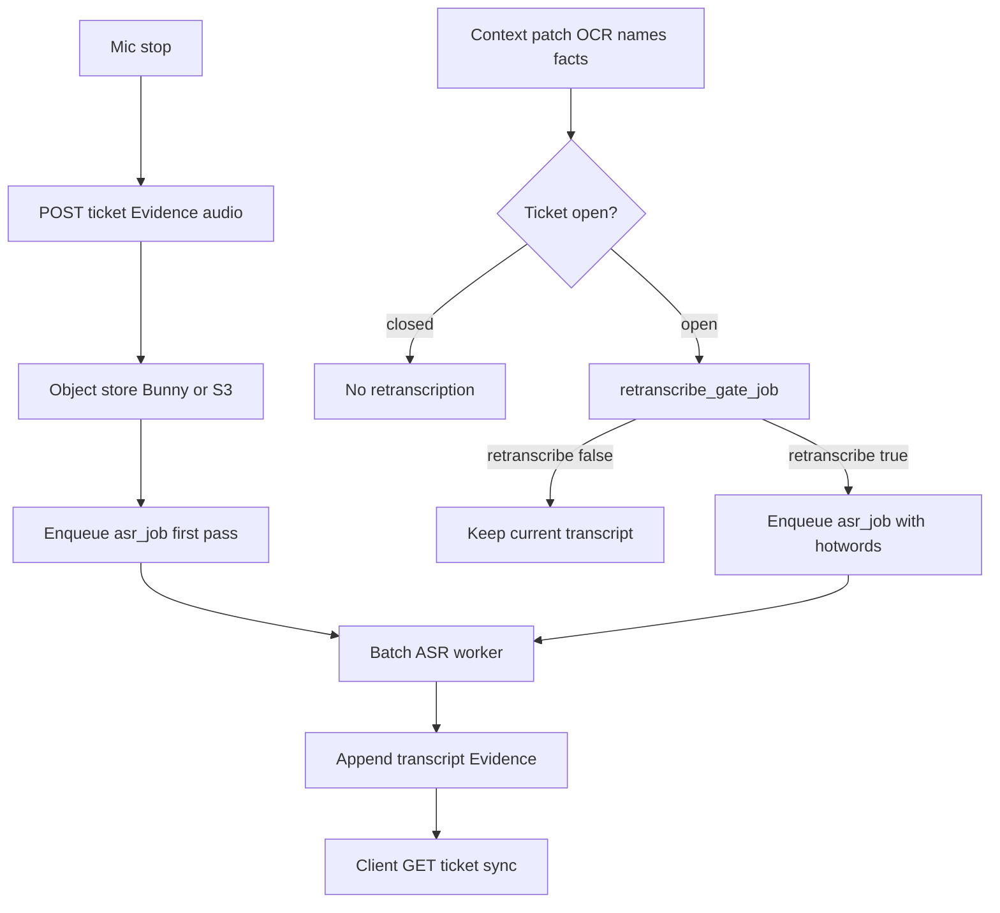

# Progressive / contextual transcription

Voice starts a **Problem ticket** by posting **audio as Evidence** (blob in cheap object store; tip holds URI). The client **never** calls an ASR / Whisper API. Transcription is a **queued, batched** server job that writes transcript Evidence back onto the ticket asynchronously.

**First audio** always enqueues cheap ASR (or a silence/duration skip). **Later context changes** on **open** tickets may trigger an **LLM gate** that decides whether to **re-transcribe** with richer hotwords / prompt context — not whether the ticket “deserves” a first transcript.

Tickets are keyed by server **`ticket_uuid`** (anonymous by default). See [`anonymous-tickets.md`](./anonymous-tickets.md).

Related: [`projects.md`](./projects.md) · [`spot-ai-mvp.md`](./spot-ai-mvp.md) · [`context-for-server.md`](./context-for-server.md) · [`capture-guidance.md`](./capture-guidance.md).

**Status:** contract / docs only — APIs and APK not built yet.

---

## One-sentence rule

> **Post audio to the ticket; always batch-transcribe the first clip; re-transcribe open tickets only when an LLM gate says new context would fix the transcript. Never upload video files — stills only.**

---

## Hard constraints

| Rule | Why |
|---|---|
| APK / web client **must not** call a public `/api/transcribe` (or equivalent) | ASR is an investigation capability of the ticket worker, not a client utility |
| Attaching **audio Evidence** enqueues first `asr_job` (unless silence/duration skip) | Avoid deadlock: gate needs a transcript to judge later |
| Context patches on **open** tickets enqueue `retranscribe_gate_job` only | LLM decides **retranscription**, not first ASR |
| **Server ticket** (Relay tip) is SoT for Evidence refs + transcripts | Audio bytes in object store (Bunny/S3-class); local cache for playback only |
| **Closed** tickets do not re-enter retranscription batches | Avoid infinite cost after the Problem is done |
| No client “Re-transcribe” button that hits ASR | User adds context; server decides |
| **No video Evidence** on the server | Camera = unique/worthy **stills** within rate limits; preview must not upload a video blob |

---

## Flow



Aligns with Projects posture: **queue → batch → write back** ([`projects.md`](./projects.md)).

---

## Evidence types

| `kind` | Who writes | Notes |
|---|---|---|
| `audio` | Client (upload) | Master clip; URI in object store; duration, mime, checksum on tip |
| `transcript` | Server (ASR worker) | Versioned text; refs parent `audio` Evidence id |
| `still` / OCR snippets | Capture path | See [`capture-guidance.md`](./capture-guidance.md); patches can feed the **retranscription** gate |
| ~~`video`~~ | — | **Not accepted** server-side |

### First ASR vs retranscription

| Event | Action |
|---|---|
| New `audio` Evidence | Always enqueue `asr_job` (or skip if below silence/duration threshold) |
| Context patch on open ticket that already has audio | Enqueue `retranscribe_gate_job`; LLM may enqueue another `asr_job` |
| Closed ticket | No ASR / gate jobs |

### Transcript versioning

Each ASR pass appends a new `transcript` Evidence row (do not overwrite):

```json
{
  "kind": "transcript",
  "audioEvidenceId": "ev_audio_…",
  "version": 2,
  "text": "…",
  "language": "en",
  "model": "whisper-large-v3",
  "contextSnapshot": {
    "knownNames": ["Ari"],
    "ocrSnippets": ["SERIAL 4X9"],
    "title": "Leaky valve under sink",
    "priorTranscriptVersion": 1
  },
  "jobId": "job_asr_…"
}
```

Clients show the **latest** version in the primary UI; earlier versions stay on the timeline for audit and for the gate.

---

## Job types

| Job | Trigger | Worker |
|---|---|---|
| `asr_job` | New `audio` Evidence (first pass) or gate “yes” | Batch ASR (Whisper on Spot / API behind worker). Writes `transcript` Evidence. Reads audio from object store. |
| `retranscribe_gate_job` | Context patch on an **open** ticket that already has audio (+ maybe a transcript) | Cheap LLM: decide whether a **new** ASR pass is worth it. |

There is **no** client-facing “transcribe this blob” endpoint. Workers load Evidence via tip refs → object store.

### Planned ticket API surface (for implementers)

| Route | Role |
|---|---|
| `POST /api/tickets` | Create open ticket (anon `ticket_uuid` + claim material) |
| `POST /api/tickets/[id]/evidence` | Attach **audio** or **stills** (audio enqueues first `asr_job`); **reject video** |
| `PATCH /api/tickets/[id]` | Context patch → if open + has audio, enqueue `retranscribe_gate_job` |
| `GET /api/tickets/[id]` | Timeline + Evidence + job status for client sync |

---

## LLM retranscription gate

**When:** after a context change on an **open** ticket that has at least one `audio` Evidence (and typically already a transcript from the first pass).

**Input (sketch):**

```json
{
  "ticketId": "…",
  "status": "open",
  "currentTranscript": { "version": 1, "text": "…" },
  "contextDelta": {
    "addedNames": ["Skinner"],
    "addedOcr": ["MODEL XJ-2"],
    "titleChanged": true
  },
  "audioDurationMs": 42000
}
```

**Output (sketch):**

```json
{
  "retranscribe": true,
  "reason": "Proper name and model string likely misheard in v1",
  "hotwords": ["Skinner", "XJ-2"]
}
```

- `retranscribe: false` → keep current transcript; optionally note gate skip on timeline.
- `retranscribe: true` → enqueue `asr_job` with hotwords / prompt context from the gate; append `transcript` vN.

Gate should prefer **skip** when the delta is cosmetic or already reflected in the text. Retranscription corrects **ASR / naming errors**, not a substitute for full Project investigation.

---

## Client sync expectations

| UI state | Meaning |
|---|---|
| `transcription: pending` | Audio Evidence accepted; first `asr_job` queued or running |
| `transcription: ready` | At least one `transcript` Evidence present |
| `transcription: updating` | Gate approved another ASR pass |

Client may keep a **local cache** of the audio file for Play / offline review. Sync of transcript text always comes from `GET` ticket — never from a direct ASR response body on upload.

---

## Video — hard no (server)

- **Start feed** = Preview + ImageAnalysis only → **no** video file upload, ever.
- Unique/worthy **stills** only, within APK + server rate limits ([`context-for-server.md`](./context-for-server.md)).
- Do **not** offer “Record video” / “Auto-record video” as a path that posts `video` Evidence.
- Optional on-device preview buffer stays on device and is discarded — never a server blob.

---

## Object store + Relay / Spot

- Tip Evidence rows point at **Bunny** (preferred) or S3-compatible URIs; infra funds storage ([`anonymous-tickets.md`](./anonymous-tickets.md)).
- `relay.ai.asr` ([`spot-ai-mvp.md`](./spot-ai-mvp.md)): batch worker reads audio from object store → Whisper → transcript Evidence. Until Spot A30, worker may call hosted Whisper **from the server**, never from the APK.
