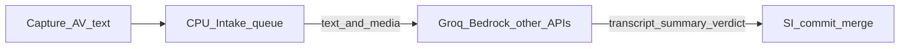

# Providers-only AI (canonical)

**Locked:** MyProblem / Relay SI does **not** run a batch GPU fleet (no Spot A30 / Florence / self-hosted Whisper workers). All AI — text decisions, ASR, stills, and video understanding — goes through **metered API providers** (Groq, Bedrock, and peers). Switch models when cost or quality underperforms. **No custom model training for MVP** — quality comes from **context** (rules, KB, tip/thread retrieval, structured schemas).

Replaces the abandoned Spot GPU MVP: [`abandoned/spot-ai-mvp.md`](./abandoned/spot-ai-mvp.md).

Related: [`backbone-escalate.md`](./backbone-escalate.md) · [`batch-phases.md`](./batch-phases.md) · [`projects.md`](./projects.md) · [`progressive-transcription.md`](./progressive-transcription.md) · [`knowledge-base.md`](./knowledge-base.md).

---

## Architecture

| Layer | Role |
|---|---|
| **CPU Intake** | Always-on cache + enqueue; hard policy gates; no frontier in the live capture loop |
| **Batch SI** | Phase 1 Cursor / Phase 2 automated drain on CPU — same procedure ([`batch-phases.md`](./batch-phases.md)) |
| **Providers** | Groq / Bedrock / peers for ASR, VL, video, Project reasoning, Clevertree curation |
| **KB + tip context** | Assembled into each call; check KB before expensive escalate |

---

## Provider / model switching

- Prefer **cheap** models (e.g. Groq Scout / 8B class, Bedrock Haiku) for gray-zone spam, short verdicts, first-pass summaries.
- Escalate or **switch** when confidence is low or eval shows underperformance (Sonnet / stronger VL / native video APIs).
- Track **$/request** (tokens × list price or provider invoice fields). Surface after successful work. Public AI stays free; cost is covered by donations and (later) private-chat revenue ([`../src/app/how-we-run/page.tsx`](../src/app/how-we-run/page.tsx) intent — no tip-push on the homepage).
- Recipes and preferred models live in public KB escalate docs — not in model weights.

### Groq free tier → Bedrock failover (text SI)

**Text** curation / SI calls prefer **Groq free tier** first, then **automatically** fall back to **Bedrock** when Groq hits limits (HTTP 429 / rate-limit / quota body; optional 5xx).

| | |
|---|---|
| Implementation | Clevertree chat-host `clevertree_chat/providers.py` (`complete_text`); probe via `action=text_complete` / `action=provider_status` |
| Enable | `CLEVERTREE_PROVIDER_FAILOVER` (default on); `CLEVERTREE_BEDROCK_FAILOVER_ON_5XX` (default on) |
| Groq | `GROQ_API_KEY`, `GROQ_TEXT_MODEL` (default `openai/gpt-oss-20b`) — **paste on pub1; never commit** |
| Bedrock | `AWS_ACCESS_KEY_ID` / `AWS_SECRET_ACCESS_KEY` / optional `AWS_SESSION_TOKEN`; `CLEVERTREE_BEDROCK_REGION` or `AWS_REGION`; `CLEVERTREE_BEDROCK_MODEL_ID` (default Haiku) |
| Missing Bedrock | Log + stay failed on Groq rate-limit (no invented keys); if Groq unset but Bedrock creds exist, use Bedrock directly |

### Manual `!investigate` (text SI only)

Text SI does **not** run on every message. CPU heuristics file claims; Groq text runs only when a human posts **`!investigate`** (optional focus text) in the channel or taps **Investigate** in the room UI.

| Soft Free-tier gate (host disk `var/clevertree-live/quota/`) | Default |
|---|---|
| Per-channel cooldown | `CLEVERTREE_INVESTIGATE_COOLDOWN_S=600` (10 min) |
| Org daily max | `CLEVERTREE_INVESTIGATE_DAILY_MAX=48` |
| Enable | `CLEVERTREE_INVESTIGATE=1` |

Ops: `action=drain_investigate`, `action=quota_status`. Deny replies: `SI: investigate cooling down…`.

**Reply handling (today):** `SI investigate:` lines are **in-channel chat only** (WS + IRC log). They are **not** auto-parsed into debate keys, counters, or tickets — humans (or a later batch/Cursor pass) act on them. Prefer `max_tokens` ≥ ~400–600 with `openai/gpt-oss-20b` (reasoning tokens can leave `content` empty at low caps). HTTP clients must send a `User-Agent` (pub1 Groq calls use `clevertree-chat/1.0`) or Cloudflare may return **403/1010**.

**ASR caveat:** channel / tip **Whisper ASR stays on Groq** (or `CLEVERTREE_ASR_DRY_RUN` / pending), automatic on media, soft-capped (`CLEVERTREE_ASR_SOFT_RPD=1500`, `CLEVERTREE_ASR_SOFT_RPM=15`), default model `whisper-large-v3-turbo`. Audio **and** video markers are ASR-eligible (speech track); there is **no** live VL / “watch the video” path yet. There is **no Bedrock drop-in** for Whisper. On Groq 429 or soft cap, ASR jobs return to `pending`.

---

## Context, not training (MVP)

| Do | Don’t |
|---|---|
| Rules + few-shot + JSON schema | LoRA / SFT as a Phase 2 gate |
| Region KB + tip retrieval before the call | Treat server weights as the knowledge store |
| Hard policy before/after LLM | Let the model be the only spam gate |
| Eval + switch provider/model | Fine-tune before automation |

Optional later: distill a cheap specialist for one high-volume narrow job if API $ justifies it. Default remains providers + context.

---

## Media (audio / video / stills)

| Job | Path |
|---|---|
| ASR | Provider API (e.g. Groq Whisper) from the **batch** / chat-host drain only — never a client `/api/transcribe`. **No Bedrock Whisper failover** (text SI only). |
| Stills / OCR / VL | Provider vision APIs |
| Deferred video | Provider video understanding (or frame package → VL); no local GPU preprocess fleet |
| Choice stills | Batch may still select/publish Bunny stills after provider analysis |

Realtime path stays stills (+ audio on APK); no live server video analysis.

---

## Cost publicity + donations

Relay Network is SI-driven and free to use. Donations / voluntary tips keep **servers** and **metered AI** running. We **publish what requests cost**. Tips are voluntary. A future educational 501(c)(3) may fund free public AI separately from Clevertree LLC products ([QuizGate 501C3 plan](../../tablet/quizgate/docs/501C3_PLAN.md)).

---

## Ordered next steps

1. Wire Intake → shared queue → batch SI calling Groq/Bedrock (ASR + text decide first).
2. Log `$/request` on each provider call; show after successful ticket/Project steps (UX).
3. Add model-switch eval sheet (correct / accurate / fast / $).
4. Video/still provider path for deferred inbox jobs.
5. KB recipes for escalate + preferred model ids.
